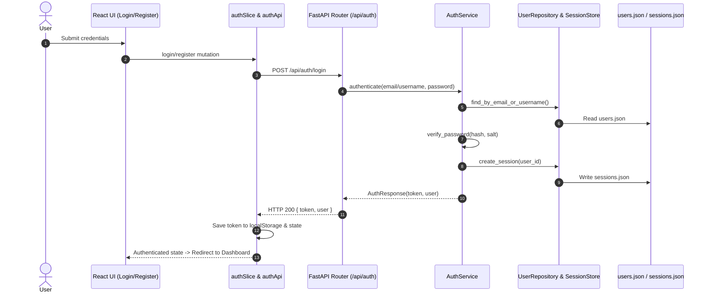

# Authentication — Architecture

## Overview
Full-stack authentication system bridging FastAPI session verification and React Redux client-side state.

## Backend Components
- `app/models/user.py`: `UserRegisterRequest`, `UserLoginRequest`, `UserResponse`, `UserInDb`, `SessionInDb`.
- `app/repositories/user_repository.py`: File-backed storage for users and session tokens.
- `app/services/auth_service.py`: Password hashing (PBKDF2-HMAC-SHA256), verification, category seeding, token resolution.
- `app/routers/auth.py`: Endpoints for register, login, logout, me.
- `app/dependencies.py`: `get_current_user` FastAPI dependency checking `Authorization: Bearer <token>`.

## Frontend Components
- `src/types/auth.ts`: TypeScript contracts for user credentials, tokens, and payloads.
- `src/store/slices/authSlice.ts`: Token, user entity, persistent authentication state.
- `src/store/api/authApi.ts`: RTK Query endpoints with automatic token header injection.
- `src/features/auth/LoginPage.tsx` & `RegisterPage.tsx`: Form UI with instant validation and error banners.
