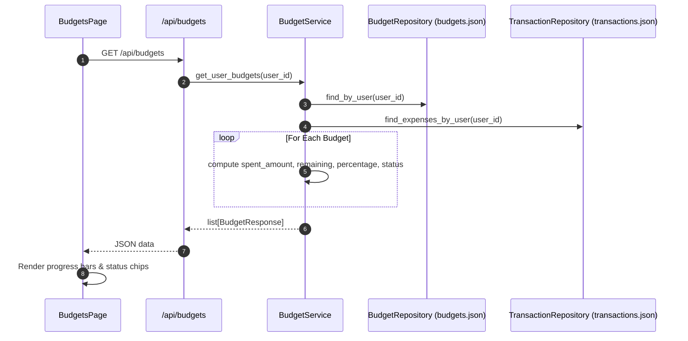

# Budgets — Architecture

## Overview
Budgets compute real-time variance by pairing planned targets with live transactional expenses.

## Backend Components
- `models/budget.py`: `BudgetCreate`, `BudgetUpdate`, `BudgetInDb`, `BudgetResponse` (including computed fields: `spent_amount`, `remaining_amount`, `percentage_used`, `status`).
- `repositories/budget_repository.py`: Storage in `backend/data/budgets.json`.
- `services/budget_service.py`: Computes spent amounts by joining transactions within dates; enforces validation rules.
- `routers/budgets.py`: REST endpoints: `GET /api/budgets`, `POST /api/budgets`, `GET /api/budgets/{id}`, `PATCH /api/budgets/{id}`, `DELETE /api/budgets/{id}`.

## Frontend Components
- `types/budget.ts`: Budget interfaces.
- `store/api/budgetsApi.ts`: RTK Query endpoints.
- `features/budgets/BudgetsPage.tsx`: Interactive grid of budget cards with progress meters, status tags, and action buttons.
- `features/budgets/BudgetDialog.tsx`: Modal for creating and editing budgets.
