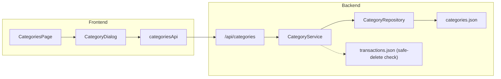

# Categories — Architecture

## Overview
Categories provide the taxonomy for all financial activity in the system. The feature spans the full stack:

## Backend Components
- `models/category.py`: `CategoryCreate`, `CategoryUpdate`, `CategoryInDb`, `CategoryResponse`.
- `repositories/category_repository.py`: File storage in `backend/data/categories.json`.
- `services/category_service.py`: Enforces uniqueness per user & type, validates safe deletion against `transaction_repository`.
- `routers/categories.py`: Endpoints for `GET /api/categories`, `POST /api/categories`, `PATCH /api/categories/{id}`, `DELETE /api/categories/{id}`.

## Frontend Components
- `types/category.ts`: Category types.
- `store/api/categoriesApi.ts`: RTK Query endpoints with cache invalidation tags (`Category`).
- `features/categories/CategoriesPage.tsx`: Tabs for Income & Expense categories, creation modal, inline edit, delete confirmation with usage checks.
