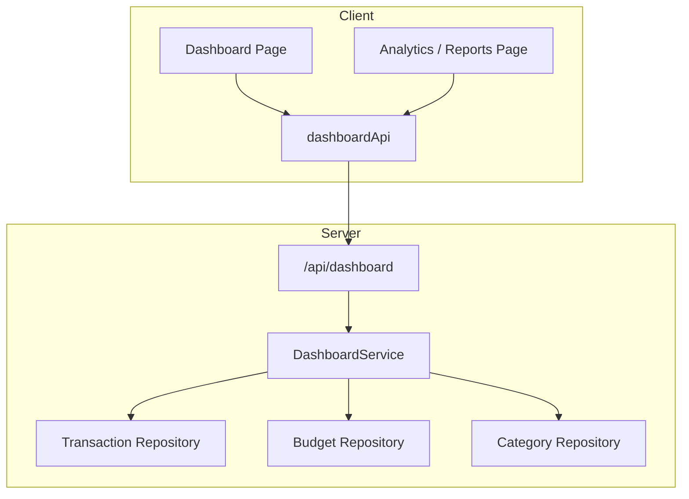

# Dashboard & Analytics — Architecture

## Overview
Aggregates live financial transactions, categories, and budgets to serve dashboard KPIs and statistics.

## Backend Components
- `models/dashboard.py`: `DashboardSummaryResponse`, `CategorySpendingItem`, `CategoryIncomeItem`, `BudgetSummary`, `MonthlyTrendItem`.
- `services/dashboard_service.py`: Computes current total balance, aggregates income/expenses for the requested period, computes category breakdowns and monthly activity bars.
- `routers/dashboard.py`: Endpoint `GET /api/dashboard/summary?period=current_month|previous_month|current_year|all`.

## Frontend Components
- `types/dashboard.ts`: Types for summary responses, charts, and breakdown items.
- `store/api/dashboardApi.ts`: RTK Query endpoint for dashboard and analytics summaries.
- `features/dashboard/DashboardPage.tsx`: Stat cards, quick action triggers, category distribution, active budget tracker, and recent transactions.
- `features/analytics/AnalyticsPage.tsx`: Period filter, category expense/income breakdowns, and month-by-month comparative trend chart.
