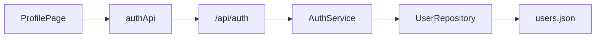

# Profile & Settings — Architecture

## Overview
Profile management provides user self-service account maintenance and security credentials updating.

## Backend Components
- `models/user.py`: `UserUpdateProfile`, `UserChangePassword`, `UserResponse`.
- `services/auth_service.py`: `update_profile(user_id, ...)`, `change_password(user_id, ...)`.
- `routers/auth.py`: `PATCH /api/auth/profile`, `POST /api/auth/change-password`.

## Frontend Components
- `features/profile/ProfilePage.tsx`: Account information display, profile form, password update form, and sign-out button.
