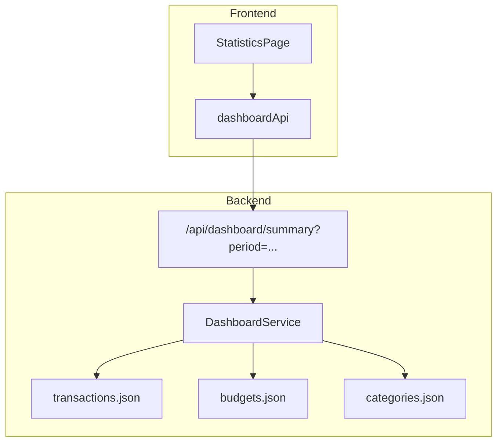

# Statistics & Analytics — Architecture

## Overview
The statistics feature aggregates transaction and budget data over configurable time periods, providing financial analytics through responsive visualizations and summary cards.

## Backend Components
- `models/dashboard.py`: `CategorySpendingItem`, `CategoryIncomeItem`, `BudgetSummary`, `MonthlyTrendItem`, `DashboardSummaryResponse`.
- `services/dashboard_service.py`: Computes all-time balance, period-specific totals, category percentages, savings rate, budget utilization, and 6-month historical trends.
- `routers/dashboard.py`: Endpoint `GET /api/dashboard/summary?period={current_month|previous_month|current_year|all}`.

## Frontend Components
- `types/dashboard.ts`: Types for summary response and period filters.
- `store/api/dashboardApi.ts`: RTK Query endpoint with `Dashboard` cache tag.
- `features/statistics/StatisticsPage.tsx`: Interactive dashboard cards, category breakdown progress bars, period toggle, and trend tables.
