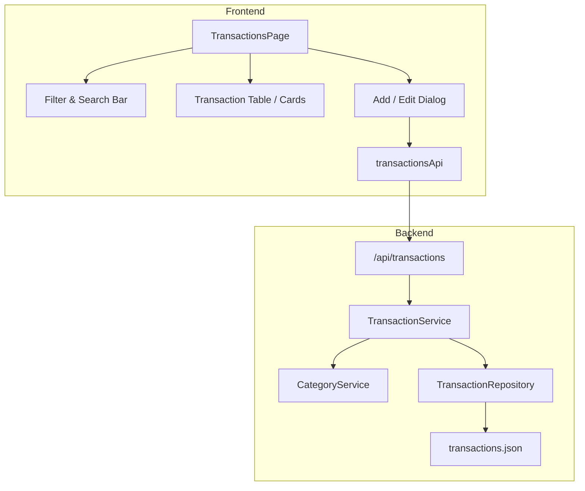

# Transactions — Architecture

## Overview
Transactions represent the fundamental financial ledger records.

## Backend Components
- `models/transaction.py`: `TransactionCreate`, `TransactionUpdate`, `TransactionInDb`, `TransactionResponse`, `TransactionQueryParams`.
- `repositories/transaction_repository.py`: Storage in `backend/data/transactions.json`.
- `services/transaction_service.py`: Filtering, sorting, category validation, user authorization.
- `routers/transactions.py`: REST endpoints:
  - `GET /api/transactions` (with query parameters: `type`, `category_id`, `start_date`, `end_date`, `search`, `sort_by`, `sort_order`)
  - `POST /api/transactions`
  - `GET /api/transactions/{id}`
  - `PATCH /api/transactions/{id}`
  - `DELETE /api/transactions/{id}`

## Frontend Components
- `types/transaction.ts`: Transaction interfaces and input types.
- `store/api/transactionsApi.ts`: RTK Query endpoints invalidating `Transaction`, `Budget`, and `Dashboard` tags.
- `features/transactions/TransactionsPage.tsx`: Data table with filters, search, sorting, color-coded badges (+ Income / - Expense), and action buttons.
- `features/transactions/TransactionDialog.tsx`: Modal form supporting both Income and Expense creation and editing.
